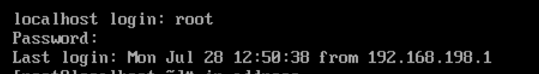

# Day7

# 云计算概念

- 通过网络将计算相关资源进行集中的管理和动态的分配

- 云计算的优势

    - 成本效益：集中管理可以减低机房、管理、环境、电力等等成本

    - 弹性扩展：用多少给多少钱

    - 全球覆盖高可用

- 云计算商业模式

    - IAAS：基础设施即服务，提供虚拟机、服务器等基础设施，阿里云，腾讯云，华为云，Azure

    - PAAS：平台即服务，提供软件运行需要的环境，SAE，AWS，GAE，Openshift

    - SAAS：软件即服务，提供完整的应用程序，用户只需要登录使用即可，百度网盘，腾讯云游戏

- 虚拟化

    - 通过软件模拟硬件，在模拟的硬件上安装操作系统

    - 资源的弹性利用

    - 资源的隔离

    - 便捷的资源迁移

    - 备份与还原

    - 由于虚拟化转换层的存在，物理资源利用率不高

    - 虚拟机系统底层维护重复浪费空间、内存

- 云原生

    - 通过软件的管理实现应用的之间的隔离

    - 通过容器技术，实现应用之间的隔离，以及应用的资源限制

    - 容器的镜像的本质上就是将运行环境，与程序的代码一起打包


- 确认docker服务已经正常工作

```C
[root@localhost ~]# docker version
Client: Docker Engine - Community    #容器的工具
 Version:           28.1.1
 API version:       1.49
 Go version:        go1.23.8
 Git commit:        4eba377
 Built:             Fri Apr 18 09:53:36 2025
 OS/Arch:           linux/amd64
 Context:           default

Server: Docker Engine - Community    #容器的服务，确保这个有版本号，容器才算真正装好了
 Engine:
  Version:          28.1.1
  API version:      1.49 (minimum version 1.24)
  Go version:       go1.23.8
  Git commit:       01f442b
  Built:            Fri Apr 18 09:51:51 2025
  OS/Arch:          linux/amd64
  Experimental:     false
 containerd:
  Version:          1.7.27
  GitCommit:        05044ec0a9a75232cad458027ca83437aae3f4da
 runc:
  Version:          1.2.5
  GitCommit:        v1.2.5-0-g59923ef
 docker-init:
  Version:          0.19.0
  GitCommit:        de40ad0

```

## 配置容器镜像加速

- 有些时候存在镜像加速失效的情况，自己多找找

- 加速地址：https://hub\.openeeds\.com/

```C
[root@localhost ~]# cat > /etc/docker/daemon.json <<EOF
> {
>   "registry-mirrors": ["https://hub.openeeds.com"],
>   "insecure-registries": ["hub.openeeds.com"],
>   "exec-opts": ["native.cgroupdriver=systemd"]
> }
> EOF
[root@localhost ~]# systemctl daemon-reload && systemctl restart docker
```



```JavaScript
cat > /etc/docker/daemon.json <<EOF
{
  "registry-mirrors": [
    "https://docker.1panel.live",
    "https://docker.m.daocloud.io"
  ],
  "exec-opts": ["native.cgroupdriver=systemd"]
}
EOF
```

# Docker

## 快速体验

- 搭建LNMP的个人网站，只需要一条命令即可

```C
docker run -d \
--name=typecho-blog \
--restart always \
--mount type=tmpfs,destination=/tmp \
-v /srv/http/typecho:/data \
-e PHP_TZ=Asia/Shanghai \
-e PHP_MAX_EXECUTION_TIME=600 \
-p 80:80 \
80x86/typecho:latest
```

- 打开浏览器访问一下


- 体验web小游戏

```C
docker run -d -p 8000:8000 -p 8787:8787  --name rpg -e HOST_IP=服务器的IP地址 registry.cn-guangzhou.aliyuncs.com/welldene/games:rpg_game
```

- 浏览器访问IP地址的:8787端口

## 核心概念

- 镜像

    - 镜像就相当于建筑的蓝图，有了蓝图可以创建很多容器出来

    - 全球最大的镜像仓库：https://hub\.docker\.com/

    - 镜像来源

        - 基于某个官方的镜像作为底，制作出自己的镜像

- 仓库

    - 存放镜像文件的场所

    - 一个仓库表示的是一个项目，比如：rockyliux仓库中保存着9\.4,9\.5,10\.0等等镜像文件

    - 仓库可以本地部署，也可以使用第三方云计算公司公开仓库（阿里云）

- 容器

    - 容器类似于一个轻量级的沙箱，容器中的环境是隔离的

    - 也可以理解一个容器就是Linux系统上的一个高级进程

## 镜像

### 获取镜像

- 默认情况下，镜像是从`hub.docker.com` 上面获取，在大陆需要使用加速才可以访问

- 可以指定镜像仓库的地址

```C
[root@localhost ~]# docker pull kalilinux/kali-rolling:latest
# docker pull 仓库的提供者/仓库名称:镜像的tag
```

### 查看镜像

```C
[root@localhost ~]# docker images
REPOSITORY               TAG       IMAGE ID       CREATED       SIZE
kalilinux/kali-rolling   latest    ad5e955171ec   6 days ago    123MB
# Size指的是解压后的大小
```

### 搜索镜像

- 只是配置下载加速，这个还是搜索不了

```C
[root@localhost ~]# docker search nginx
# 使用命令行搜索hub.docker.com中的镜像仓库
```

### 删除镜像

```C
[root@localhost ~]# docker rmi 3437f7346b4c
# 可以加上镜像的ID或者是镜像的名字

[root@localhost ~]# docker image prune -a
# 清理所有没有被使用的镜像
```

### 导出镜像

```C
[root@localhost ~]# docker save -o kali.tar kalilinux/kali-rolling:latest
# 推荐使用镜像名来保存
# .tar是打包格式，并不会压缩

[root@localhost ~]# gzip kali.tar
# 可以使用gzip命令压缩.tar的包
```

### 导入镜像

```C
[root@localhost ~]# gzip -d kali.tar.gz
# 如果是.tar.gz的格式，先解压

[root@localhost ~]# docker load -i kali.tar
# 导入镜像，-i显示导入进度
```

## 容器

### 运行容器

- 容器是为了执行某个任务而创建的，一旦任务执行结束，或者任务被阻塞，都会导致容器退出

    - 任务执行结束

    - 阻塞，等待用户的输入，任务进入后台，等等让任务无法立即执行下去的情况

```C
[root@localhost ~]# docker run kalilinux/kali-rolling:latest
# 后面是运行的镜像名

[root@localhost ~]# docker run -i -t kalilinux/kali-rolling:latest
# -i 保持标准输入打开，-t 分配一个终端，-it就是打开一个终端，并且保持输入状态，不要阻塞

[root@localhost ~]# docker run -d centos:7 ping qq.com
# -d 当前的容器自动进入后台运行
# 镜像名称后面的所有命令都是让容器内部去执行的

[root@localhost ~]# docker run -d --name ping centos:7 ping qq.com
# --name 指定此容器的名称

[root@localhost ~]# docker run -d --name ping -h ping_qq centos:7 ping qq.com
# -h 设置容器内的主机名，默认的容器名是此容器的ID
```

### 查看容器

```C
[root@localhost ~]# docker ps
# 查看正在运行中的容器

# cat /etc/os-release 检查当前版本配置

[root@localhost ~]# docker ps -a
# 查看所有的容器，包括已经退出的

[root@localhost ~]# docker ps -l
# 查看最后一个创建容器

[root@localhost ~]# watch -n 1 docker ps -a
# 每隔1s查看一次容器信息
```

### 查看容器的日志

- 容器的日志就是容器运行产生的显示内容

```C
[root@localhost ~]# docker logs 7067bd807f06
# 后面可以跟上容器的ID或者是容器的名称

[root@localhost ~]# docker logs -f 7067bd807f06
# -f 持续关注容器日志的变化

[root@localhost ~]# docker inspect f065
# 查看容器的配置信息
```

### 进入容器

- 使一个正在运行的容器运行某个特定的指令

```C
[root@localhost ~]# docker exec ping touch file
[root@localhost ~]# docker exec ping ls
# 其中ping指定的容器名，后面是需要容器执行的命令

[root@localhost ~]# docker exec -it ping bash
# 如果命令需要交互，需要加上-it
```

- 直接进入到容器的前台

```C
[root@localhost ~]# docker attach ping
# 进入到容器的前台界面，如果此时打断应用，容器就会退出
```

### 删除容器

```C
[root@localhost ~]# docker rm ping
# 只能删除一个已经exit的容器

[root@localhost ~]# docker rm -f ping
# 删除正在运行的容器

[root@localhost ~]# docker rm -f `docker ps -qa`
# docker ps -qa 是获取所有的容器id
# ` 反引号，在bash会优先执行，然后执行结果会带入命令中
```

### 停止/启动容器

```C
[root@localhost ~]# docker start ping
# 重新开始一个exit的容器

[root@localhost ~]# docker stop ping
# 通知容器的前台任务，该结束了

[root@localhost ~]# docker kill ping
# 直接停止容器运行，但是存在数据丢失的风险
```

## 容器网络

- 如果需要保留容器的端口给外面的访问

    - `-p` 的方式映射出去，Docker会自动处理好防火墙

```C
[root@localhost ~]# docker run -d -p 8080:80 nginx
# -p 映射容器的端口，  宿主机端口:容器端口

[root@localhost ~]# docker run -d -p 10086:80 -p 10010:8080 nginx
......Bind for 0.0.0.0:10086 failed: port is already allocated
# 如果报错是这样的，说明宿主机的端口已经被占用了

[root@localhost ~]# docker run -d --network host nginx
# 容器所有的端口都会被开放到宿主机的对应端口上，需要注意防火墙

[root@localhost ~]# firewall-cmd --add-port 80/tcp --permanent
success
[root@localhost ~]# firewall-cmd --reload
success

[root@localhost ~]# docker run -d -P nginx
# 在启动容器的时候，随机选择端口号映射给容器声明的端口
```

## 容器数据

- 在容器内部的数据都不是持久的，随着容器的删除，容器内部数据就被删除

    - 建议：容器仅作为运行环境，或者运行工具，所有的需要保存的数据都不放在容器中

- 需要将主机上的目录挂载到容器中

```C
# 提前创建好文件夹
[root@localhost nginx]# docker run -d -p 80:80 -v /web/nginx:/usr/share/nginx/html nginx
# -v  宿主机上的目录位置:容器中的目录位置
```

- 下载code\-server

```MATLAB
[root@localhost ~]# docker pull linuxserver/code-server:latest
```

- 我们可以开启一个开发环境，和Nginx挂载同一个目录，这样就可以做到开发和上线自动实现

```C
docker run -d \
--name=codeserver \
-e DEFAULT_WORKSPACE=/config/workspace \
-e PASSWORD=123 \
-e SUDO_PASSWORD=123 \
-p 8443:8443 \
-v /home/docker/code-server/config:/config \
-v /web/nginx:/config/workspace \
-v /run/docker.sock:/var/run/docker.sock \
-v $(which docker):/usr/bin/docker \
--restart always \
--privileged=true \
linuxserver/code-server:latest

[root@localhost web]# chmod -R o+w nginx/        # 需要权限
```

## 案例kodbox

- 一键部署kodbox企业网盘，要求可以管理Nginx的网站根目录

    - 创建Nginx容器，将/web/nginx挂载到容器的网站根目录中

    - 创建kodbox容器，将/web/nginx目录挂载到kodbox中

    - 在kodbox中可以直接编写Nginx网站的页面内容

```C
[root@localhost ~]# mkdir -p /web/nginx
[root@localhost ~]# docker run -d -p 80:80 -v /web/nginx:/usr/share/nginx/html --name webserver nginx
[root@localhost ~]# docker run -d -p 8080:80 -v /data:/var/www/html -v /web/nginx:/web kodcloud/kodbox:latest
[root@localhost ~]# chmod -R o=rwx /web
```


## nginx的反向代理

```MATLAB
docker run -d -p 80:80 \
-v /web/nginx:/usr/share/nginx/html \
-v /web/nginx/conf.d:/etc/nginx/conf.d \
--name webserver nginx

# 创建目录
mkdir -p /web/nginx/conf.d
# 删除旧容器
docker stop webserver
docker rm webserver
# 启动新nginx容器
docker run -d -p 80:80 \
-v /web/nginx:/usr/share/nginx/html \
-v /web/nginx/conf.d:/etc/nginx/conf.d \
--name webserver nginx

location = /kodbox {
    return 301 /kodbox/;
}
location ^~ /kodbox/ {
    proxy_pass http://kodbox:80/;
    proxy_set_header Host $host;
    proxy_set_header X-Real-IP $remote_addr;
    proxy_set_header X-Forwarded-For $proxy_add_x_forwarded_for;
    proxy_set_header X-Forwarded-Proto $scheme;
    proxy_http_version 1.1;
    proxy_set_header Upgrade $http_upgrade;
    proxy_set_header Connection "upgrade";
    proxy_buffering off;
}
```

- 创建容器之间的互通网络

```MATLAB
# 创建网络
docker network create kod-net
# 把已有容器加入网络
docker network connect kod-net nginx
docker network connect kod-net kodbox
```

